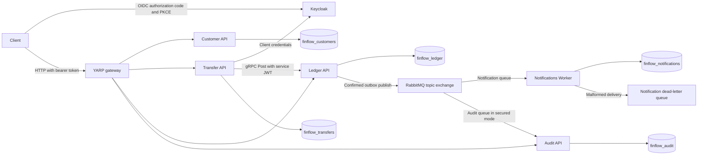
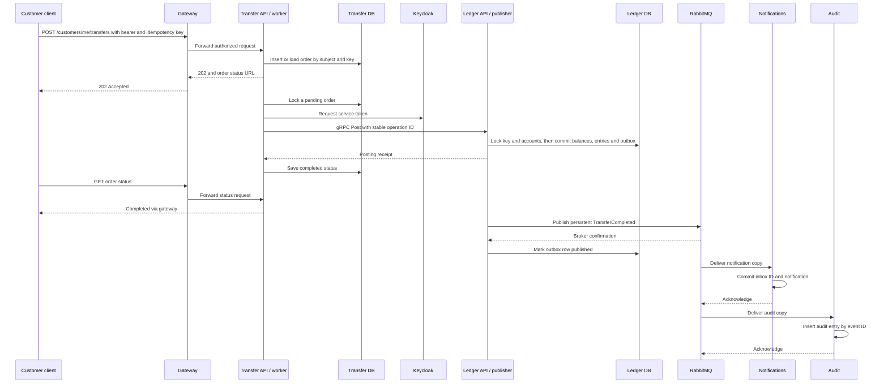

# FinFlow current implementation

This walkthrough describes the code at the start of the walkthrough task. Start with [FinFlow.slnx](../FinFlow.slnx). The [base Compose file](../compose.yaml) runs the original loopback demo with Ledger and Notifications. The [secured overlay](../compose.secure.yaml) adds Keycloak, YARP, Customers, Transfers, and Audit. Each application owns a separate PostgreSQL database. The local stack hosts those databases in one PostgreSQL instance.

## Solution structure

| Project | Responsibility and source entry point |
| --- | --- |
| **FinFlow.Gateway** | Public HTTP entry point in secured mode. [Program.cs](../src/FinFlow.Gateway/Program.cs) registers YARP, per-subject rate limiting and request correlation. [appsettings.json](../src/FinFlow.Gateway/appsettings.json) maps paths and policies to internal APIs. |
| **FinFlow.Authentication** | Shared JWT configuration and role policies. [FinFlowIdentity.AddFinFlowIdentity](../src/FinFlow.Authentication/FinFlowIdentity.cs) is called by the gateway and the secured APIs. |
| **FinFlow.Customers.Api** | Owns `finflow_customers`. [CustomerEndpoints.Register, UpdateOwn and SetStatus](../src/FinFlow.Customers.Api/CustomerEndpoints.cs) handle profile registration, profile edits, and staff-controlled simulated KYC. Identity comes from the JWT subject. [CustomersDb](../src/FinFlow.Customers.Api/CustomersDb.cs) maps profiles and the PostgreSQL row version used for concurrent edits. |
| **FinFlow.Transfers.Api** | Owns `finflow_transfers`. [TransferEndpoints.Submit, Get and List](../src/FinFlow.Transfers.Api/TransferEndpoints.cs) accept and expose customer-owned orders. [PostingWorker](../src/FinFlow.Transfers.Api/PostingWorker.cs) sends orders to Ledger over authenticated gRPC. |
| **FinFlow.Ledger.Api** | Owns `finflow_ledger`. [Accounts.Open and ListOwned](../src/FinFlow.Ledger.Api/Accounts.cs) provision and read accounts. [Transfers.PostAsync](../src/FinFlow.Ledger.Api/Transfers.cs) moves money and writes entries and outbox events. [LedgerQueries](../src/FinFlow.Ledger.Api/LedgerQueries.cs) uses Dapper for statements and reconciliation. |
| **FinFlow.Ledger.Contracts** | Shared [ledger.proto](../src/FinFlow.Ledger.Contracts/ledger.proto) generates the gRPC client and server types used by Transfers and Ledger. |
| **FinFlow.Messaging** | Shared [TransferCompleted](../src/FinFlow.Messaging/TransferCompleted.cs) event contract and [RabbitTopology](../src/FinFlow.Messaging/RabbitTopology.cs) queue and exchange declarations. |
| **FinFlow.Notifications.Worker** | Owns `finflow_notifications`. [NotificationConsumer](../src/FinFlow.Notifications.Worker/NotificationConsumer.cs) reads RabbitMQ deliveries and calls [NotificationsDb.StoreAsync](../src/FinFlow.Notifications.Worker/NotificationsDb.cs) to persist notifications for destination accounts. |
| **FinFlow.Audit.Api** | Owns `finflow_audit`. [AuditConsumer](../src/FinFlow.Audit.Api/AuditConsumer.cs) builds a minimal transfer history from events. [AuditQueries.ListTransfers](../src/FinFlow.Audit.Api/AuditQueries.cs) serves filtered, paginated audit records to authorized callers. |
| **FinFlow.Tests** | [LedgerTests](../tests/FinFlow.Tests/LedgerTests.cs) and [DeliveryTests](../tests/FinFlow.Tests/DeliveryTests.cs) exercise PostgreSQL and RabbitMQ through Testcontainers. The [secured smoke script](../tests/smoke-secure.mjs) follows login and the gateway workflows. |

## Architecture



## Authentication and routing

1. The [Keycloak realm](../infrastructure/keycloak/finflow-realm.json) defines the public `finflow-portal` client with S256 PKCE, synthetic users, and role and audience mappers. Keycloak handles credentials and issues access tokens with audience `finflow-api`. A customer profile is a separate record created via `POST /customers/me` after sign-in.
2. [FinFlowIdentity.AddFinFlowIdentity](../src/FinFlow.Authentication/FinFlowIdentity.cs) configures JWT bearer validation with Keycloak discovery, expected issuer and audience, and the `roles` claim. The [Compose overlay](../compose.secure.yaml) sets the browser-facing issuer and internal discovery address. The gateway applies route policies and forwards the bearer token. The destination API validates that token and applies its own policies.
3. Customer endpoints scope profile and order queries to `sub`. Ledger checks account ownership using the same subject. BankOperator and Administrator can use staff ledger and customer routes. Auditor and Administrator can read audit records. The internal posting endpoint requires the `LedgerPoster` role and `azp=finflow-transfers`; [PostingWorker.GetAccessTokenAsync](../src/FinFlow.Transfers.Api/PostingWorker.cs) obtains that token with client credentials.

## Money transfer and gRPC

1. `POST /customers/me/transfers` goes through YARP to [TransferEndpoints.Submit](../src/FinFlow.Transfers.Api/TransferEndpoints.cs). It validates the input and inserts a pending order under a unique `(Subject, Key)` index. A repeat with the same payload returns the same order, with its current status. A different payload for the same key returns HTTP 409. The accepted response uses HTTP 202 and links to the status endpoint.
2. [PostingWorker.DispatchNextOrderAsync](../src/FinFlow.Transfers.Api/PostingWorker.cs) locks one due order using `FOR UPDATE SKIP LOCKED`. [PostOrderAsync](../src/FinFlow.Transfers.Api/PostingWorker.cs) makes a timed gRPC call to the private Ledger HTTP/2 endpoint, using the order ID as the operation ID. The typed contract passes the owner subject, both account IDs, and the integer amount in tetri.
3. [LedgerPostingService.Post](../src/FinFlow.Ledger.Api/LedgerPostingService.cs) calls [Transfers.PostAsync](../src/FinFlow.Ledger.Api/Transfers.cs). The Ledger transaction locks the scoped idempotency key, checks for an existing posting, then locks both account rows in ID order. It verifies ownership of the source, sufficient funds, and the destination balance limit. It commits the debit, credit, transfer, both signed entries, and outbox event together.
4. The worker saves a completed or rejected order in the Transfer database. If the call fails or its outcome is uncertain, it schedules another attempt using the same operation ID. If Ledger already committed, the unique `(Scope, IdempotencyKey)` index and replay check let it return the original posting. [LedgerDb](../src/FinFlow.Ledger.Api/LedgerDb.cs) defines that index. The [ledger migrations](../src/FinFlow.Ledger.Api/Migrations/) enforce nonnegative balances, balanced postings at commit, and immutability of posted rows.

The staff and v0.1 demo `POST /transfers` route calls `Transfers.Create` and posts synchronously through the same `PostAsync` method. It uses the HTTP key scope and returns HTTP 201. The following excerpt shows the durable write boundary:

```csharp
db.Transfers.Add(transfer);
db.Outbox.Add(OutboxMessage.FromTransfer(transfer));
// Both ledger entries are added here before saving.
await db.SaveChangesAsync(cancellationToken);
await transaction.CommitAsync(cancellationToken);
```



The publisher and order worker run independently after the Ledger commit. A notification can be stored before the Transfer API reports the order as completed.

## RabbitMQ, outbox, and consumers

- **Outbox.** [OutboxMessage.FromTransfer and OutboxPublisher.PublishBatchAsync](../src/FinFlow.Ledger.Api/OutboxPublisher.cs) serialize the event into the posting transaction, then publish pending rows as persistent, mandatory messages. The publisher writes `PublishedAt` after broker confirmation. Failed attempts remain pending. A crash after publish and before marking the row can lead to redelivery.
- **Routing.** [RabbitTopology.DeclareAsync and DeclareAuditQueueAsync](../src/FinFlow.Messaging/RabbitTopology.cs) bind independent durable queues to the `finflow.events` topic exchange with `ledger.transfer-completed.v1`. The publisher declares the audit binding when audit is enabled, so a stopped Audit API can catch up.
- **Notification inbox.** [NotificationConsumer.ConsumeAsync](../src/FinFlow.Notifications.Worker/NotificationConsumer.cs) validates the delivery, then [NotificationsDb.StoreAsync](../src/FinFlow.Notifications.Worker/NotificationsDb.cs) inserts the processed-event ID and its notification in one transaction. A duplicate ID results in a no-op. The consumer acknowledges after commit. For malformed messages, `DeadLetterAsync` publishes a persistent copy to `finflow.notifications.dead-letter`, waits for confirmation, then acknowledges the original.
- **Audit deduplication.** [AuditConsumer.ConsumeAsync](../src/FinFlow.Audit.Api/AuditConsumer.cs) inserts a minimal record with `ON CONFLICT ("EventId") DO NOTHING`, then acknowledges. The event ID acts as both projection key and deduplication marker. [Audit migrations](../src/FinFlow.Audit.Api/Migrations/) prohibit updates and deletes of posted audit rows. In this snapshot, malformed audit messages are rejected; Audit has no dead-letter queue.

## Implemented patterns and remaining work

| Implemented pattern | Purpose in FinFlow |
| --- | --- |
| Database per service and eventual consistency | Ledger owns balances. Transfer status, notifications, and audit records follow the committed posting across service boundaries. |
| Lightweight command/query separation | Posting enforces invariants in `Transfers.PostAsync`. Statements and reconciliation use Dapper in `LedgerQueries` against the same Ledger database. |
| Idempotency and concurrency control | Unique scoped keys and row locks protect money movement and retries. The order worker locks work across replicas. Customers uses optimistic concurrency for profile updates. |
| Transactional outbox and inbox-style deduplication | Committed postings survive broker outages. Consumers handle at-least-once delivery without repeating their database effects. |
| Append-only financial and audit records | PostgreSQL triggers protect postings and audit rows from edits. |

**Planned at this snapshot:** payment simulation and compensation, payment Saga and event sourcing, customer and transfer lifecycle events beyond ledger completion, broader audit coverage, bounded consumer retry policies, Valkey cache-aside, Mailpit and SignalR notifications, Angular portals, full observability, Aspire, Kubernetes, and Woodpecker CI. See the [roadmap](../PROJECT_PLAN.md) and [live project status](../PROJECT_STATUS.md).
