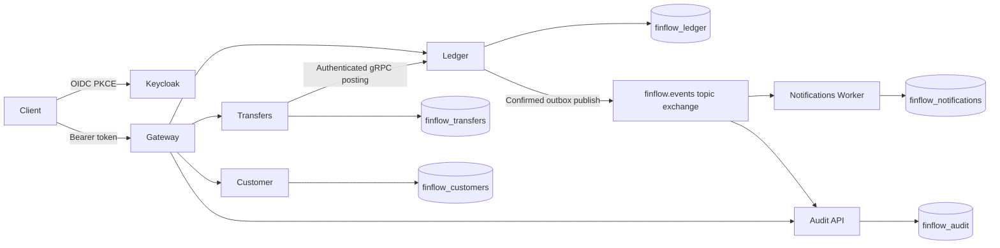
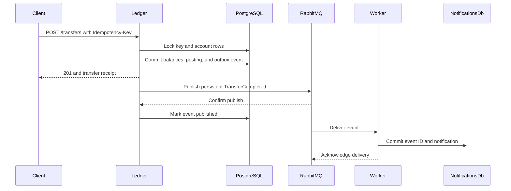

# Current architecture

The original v0.1 Compose mode runs the Ledger API, Notifications Worker, PostgreSQL, and RabbitMQ. The secured mode adds Keycloak, the YARP gateway, and the Customer and Transfer APIs. Gateway routes apply role policies and rate limits. Each secured API also validates the signed bearer token.

Customer records are keyed by the Keycloak subject and do not contain credentials. Registration and profile updates are self-service. Staff manage status and simulated KYC in the Customer API and provision accounts in the Ledger API. Customer account lists, statements, and transfer history are scoped to the bearer token subject. The original transfer routes remain available to staff in secured mode.

The Transfer API stores a pending order before contacting the Ledger. A background worker locks the order while making a bounded gRPC call with a service-account token. The order ID serves as the Ledger's idempotency key for retries. The Ledger validates source ownership under account locks before posting.

Each application migrates its own database. PostgreSQL enforces balanced postings at transaction commit and rejects changes to posted entries and transfers. The statement query pages over immutable postings ordered by completion time and transfer ID. Reconciliation checks that every transfer has one matching signed debit and one matching signed credit.

The durable `finflow.events` topic exchange routes `ledger.transfer-completed.v1` to the notification queue and, in secured mode, to a separate audit queue. New events carry correlation and causation identifiers in the persisted payload. Audit stores a minimal, append-only projection and deduplicates by event ID. The notification worker confirms a copy of a malformed delivery to its dead-letter queue before acknowledging the original.

